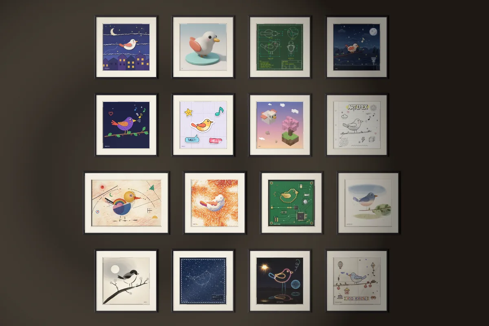

# Artifex

[](site/pieces/wall.cjs)

**Art from code: one seeded piece draws a page, a PNG, an SVG and a film with sound, and each file carries the recipe that redraws it.**

The picture above is one frame of [`site/pieces/wall.cjs`](site/pieces/wall.cjs) at seed 1: every mark in it was drawn by code. The same seed draws the same picture again, a declared parameter changes one thing in a piece, and `npm run replay` proves a saved file still matches its recipe.

Artifex is a JavaScript library and agent skill for making art from code. A piece can produce a page, PNG, an MP4 film with its own soundtrack (WebM where a browser cannot encode that film), or supported SVG.

Use it for seeded compositions, animation with sound, and vector artwork. It does not generate images from text or judge artistic quality.

## Quick start

Requires Node.js 22 or later; [`.nvmrc`](.nvmrc) pins the development version. PNG contact sheets and time strips (`--png`), `npm run film`, a PNG from `npm run still`, and replay of a PNG or film also need an installed Microsoft Edge, or Google Chrome or Chromium where Edge is absent. From a local checkout, run:

```shell
npm run page
```

Example output; size and module count depend on the checkout:

```text
out/index.html  799.0 kB  41 modules, no dependencies
```

The command writes `out/index.html` and prints its size and bundled module count. Open that file in a browser to select an example and export artwork.

No dependency installation, build toolchain, account, or network service is required. Video export needs browser APIs described in [output formats](docs/knowledge/output-formats.md).

## Use the agent skill

The plugin bundles the library with [the Artifex skill](skills/artifex/SKILL.md). It guides an agent through authoring a piece, rendering it, and reviewing multiple seeds.

Install it from this repository. Each host clones it, so the installed copy holds the repository's files and nothing else. The `--sparse` folders below are the ones the plugin uses, so Claude Code and Codex leave out the tests, the showcase site and the studies, about 5 MB of the 10.

With Claude Code installed:

```shell
claude plugin marketplace add V-Songbird/artifex --sparse .claude-plugin core skills tools examples assets docs
claude plugin install artifex@artifex
```

With Codex CLI installed:

```shell
codex plugin marketplace add V-Songbird/artifex --sparse .agents --sparse core --sparse skills --sparse tools --sparse examples --sparse assets --sparse docs
codex plugin add artifex@artifex
```

With the Antigravity CLI installed:

```shell
agy plugin install https://github.com/V-Songbird/artifex
```

Antigravity has no sparse option, so its copy holds every file in the repository.

To try a change of your own, give the same commands the path of your checkout instead. A local-path install can copy files Git does not track, so use it for development only.

Ask your host: “Use the Artifex skill to make a seeded SVG poster and render nine variations.”
The expected result is piece source and rendered artwork for review; the skill is guidance, not a standalone renderer.

The repository contains manifests for these hosts. Installation and skill discovery depend on the installed client; manifest consistency alone does not establish host compatibility.

## Render and compare

From the checkout root, render all registered vector examples:

```shell
npm run examples
```

This writes SVG files under `out/` and reports raster-only examples as skipped. Compare one example across nine seeds:

```shell
npm run seeds -- drift 9 0.5
```

Open `out/drift-seeds.html` to inspect seeds 1 through 9 at playhead 0.5. Names come from [the example registry](examples/index.js).

The library has no required configuration file or environment variables. Piece definitions set dimensions, seed, parameters, outputs, and timeline.

## Write a piece

The [piece API](docs/apis/piece-api.md) provides a copyable example that writes one horizontal stroke to `out/first.svg`.
Use `validate` and `solve` to build state, `drawFrame` for a canvas surface, or `renderVector` for SVG.

Save a CommonJS piece as `first.cjs` in your own project:

```javascript
module.exports = {
  name: 'first',
  size: { w: 400, h: 300 },
  outputs: ['raster', 'vector'],
  draw(g) {
    g.fillStyle = '#f5efe1';
    g.fillRect(0, 0, 400, 300);
    g.fillStyle = '#295c7b';
    g.fillRect(50, 60, 300, 180);
  },
};
```

From that project, replace `/path/to/artifex` with the absolute library or installed-plugin directory, keeping quotes around paths:

```shell
npm --prefix "/path/to/artifex" run page -- "./first.cjs"
npm --prefix "/path/to/artifex" run seeds -- "./first.cjs" 9 0.5
```

Open `first-page.html` or `first-seeds.html` beside your source file. Neither command changes the example registry or writes into the installed plugin.
Relative piece paths use the directory where you invoked npm. Direct `node` invocations use their current directory.

External bundles support direct, unshadowed literal `require(...)` calls. Helpers must use browser-compatible CommonJS `.js`/`.cjs` or JSON.
Imports inside template interpolation and any template literal containing literal `</script` text are unsupported. Use ordinary quoted strings or JSON for that data.
Loading a piece executes trusted local code; Node builtins and dynamic imports are unsupported in the browser bundle.
See [external-piece behavior](docs/knowledge/command-line-tools.md#external-pieces) for naming, dependencies and parameter sweeps.

For fixed source, data, parameters, rendering configuration, and execution environment, repeated seed/playhead pairs should reproduce the same frame.
Arbitrary drawing code must uphold that requirement; cross-browser pixel equality is not guaranteed.

## Output limits

SVG requires a piece that declares vector support and uses supported drawing operations. Raster-only pieces are valid.
MP4 export requires an animated piece and a browser with WebCodecs H.264 encoding. WebCodecs is the browser's built-in video and audio encoder; H.264 is the usual MP4 video format.
A piece that declares sound also needs AAC or Opus encoding, two common audio formats. It gets AAC wherever the browser encodes it. It keeps every frame however slowly the piece draws. The page offers WebM export only where the browser cannot encode that MP4. WebM records in real time, so it needs frames cheaper than their frame budget, and carries no sound. See [format behavior and export checks](docs/knowledge/output-formats.md).

## Troubleshooting

If the seed tool reports `no example called`, use a name from [the registry](examples/index.js) or an explicit path such as `./first.cjs`.
If a tool refuses `--style <name>`, that is expected. A style, built in or a [style pack](docs/apis/style-packs.md), is a guide and mark functions for your own piece, not a picture. For a known style, the refusal names both files; for an unknown name, it lists the styles available.
An external module error identifies the missing file, invalid piece field or unsupported dependency; use CommonJS code that can run in a browser.
An SVG error naming an unsupported operation means the drawing needs a supported vector operation or raster output.

## Development

From the repository root:

```shell
npm run check
```

This runs lint and the Node test suite. See [contributing](docs/CONTRIBUTING.md) for change guidance and [development](docs/knowledge/development.md) for all commands.

## Support

- Learn the contract: [piece API](docs/apis/piece-api.md).
- Change the project: [contributing](docs/CONTRIBUTING.md).
- Report a reproducible bug or ask a usage question: use [GitHub issues](https://github.com/V-Songbird/artifex/issues).
- Report a vulnerability privately through the [security policy](docs/SECURITY.md).

## License

[MIT](LICENSE).
