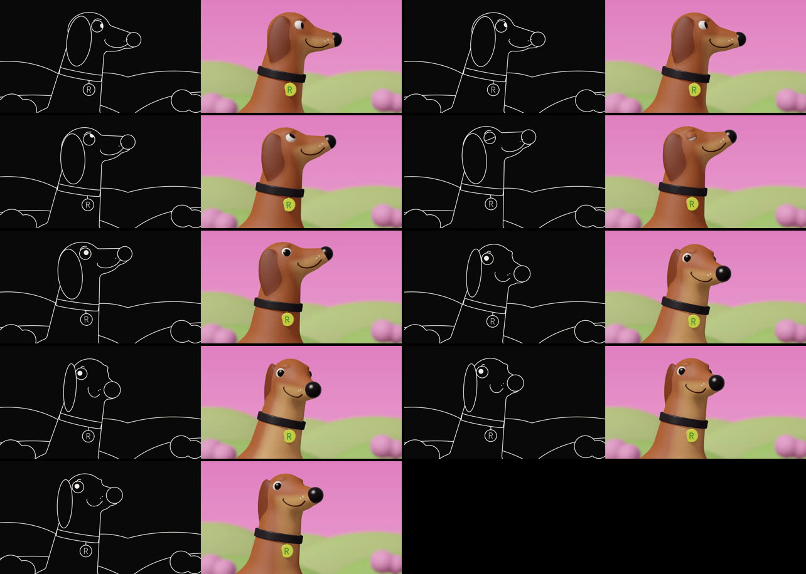
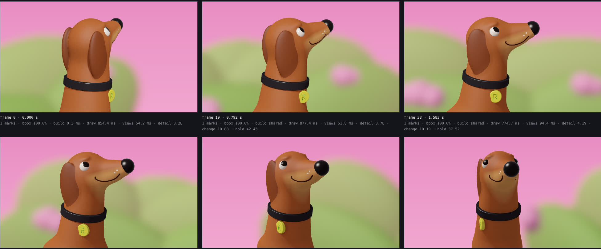
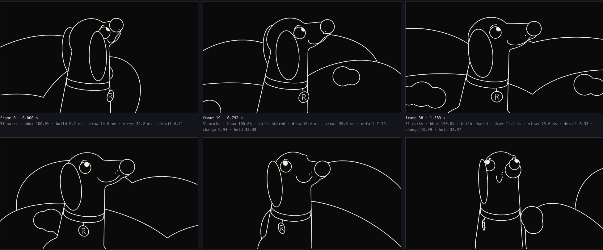

# Study: one animation, two styles

A study made to answer one question: can Artifex match the look of a short
video that showed a cartoon dachshund in ten styles, in particular its clean
lines and its smooth, soft 3D? It is a study, not a library example: the
pieces here depict one subject, so nothing in them belongs in a shared
helper, a style guide or the skill ([subject neutrality](../../docs/knowledge/subject-neutrality.md)).
What the study taught that holds for any subject went into the guides; see
[lessons](#lessons).



## Contents

- [The reference](#the-reference)
- [What was built](#what-was-built)
- [Running it](#running-it)
- [Results](#results)
- [What it does not match](#what-it-does-not-match)
- [Lessons](#lessons)

## The reference

The video (vertical, 25 s, ten styles: soft 3D, flat cartoon, line art,
halftone print, 16-bit pixel, ink silhouette, vintage comic, 8-bit sprite,
paper cutout, 90s low poly) was read frame by frame at 5 frames a second. It
was almost certainly made by a generative video model, not by code:

- In the line-art clip, the ears change outline from frame to frame, the hind
  legs appear and disappear and the hills slide.
- In the halftone clip, the dot pattern crawls and the legs re-form.
- The soft-3D clip has depth of field and translucent clay skin that nothing
  modelled.
- The pose differs between styles, so the clips are separate generations, not
  one animation restyled.

So the question became which of the ten looks a piece written in code can
reach. Seven or eight have a built-in style close to them
([style catalog](../../skills/artifex/styles/catalog.md)). The study built the
two the video was praised for.

## What was built

| File | What it is |
| --- | --- |
| [`rig.cjs`](rig.cjs) | The animation, written once: a 3D model of the dog (ellipsoids, round cones, spheres, a collar ring and a tag disc), the camera, and the motion tracks over 6 seconds. It draws nothing; `pose(seconds)` returns everything a style needs. |
| [`dachshund-line.cjs`](dachshund-line.cjs) | The rig as white line art on black. |
| [`dachshund-soft3d.cjs`](dachshund-soft3d.cjs) | The rig raymarched as a soft-lit clay toy, led by the [3D render style](../../skills/artifex/styles/render-3d.md). |
| [`orbit-soft3d.cjs`](orbit-soft3d.cjs), [`orbit-line.cjs`](orbit-line.cjs) | Checks: the pose frozen at 2 s and the camera orbiting the dog, so a model built for one side, or a drawing that is not really 3D, shows at once. They swap `rig.pose` for the length of one `draw` call and put it back. |

**The motion.** The dog looks up at the sky, blinks, turns its head about
60 degrees to look at the camera and settles in three-quarter view. The eyes
aim at targets in the world (ahead, the sky, then the camera), so both eyes
look at one place from any angle. The ears and the tag trail the head on
springs (`follow` from `core/time.js`), the head moves between poses with
`flow`, and the camera dollies slowly for parallax.

**The model.** Paired parts (eyes, ears, brows, the smile and the dots) are
written for the left side and mirrored. In the distance field, a mirror is the
absolute value of the head-frame z, so one primitive serves both sides.

**The line piece.** Every outline is the model's own outline through the
camera. An ellipsoid's outline in perspective is the ellipse its dual quadric
projects to; a round cone's is the convex hull of its two spheres' outlines.
The chest, neck, skull, snout, jaw and brows are united into one silhouette,
then closed (grown and shrunk by one radius with round joins) so their joins
get the fillets a smooth union gives in 3D. Parts are drawn back to front,
each filled with the ground colour before it is inked, so a part in front
hides the lines behind it. A paired part on the far side is drawn before the
head, or left out when it faces away. The line is one constant width with
round caps and joins, and nothing wobbles, so nothing boils between frames.

**The soft-3D piece.** Each part of the rig is a signed-distance primitive.
Head parts blend with smooth unions; the ears join the head with a small
fillet; the eyes, nose, collar and tag stay crisp and have their own material
ids, so their silhouettes are anti-aliased. Written here, beyond the style's
marks: a warm wrap term that reads as light soaking into clay, a fine grain in
the albedo, the smile, dots and tag letter painted on the surface, and a
background rendered at a sixth of the size and blurred so it reads as out of
focus.

## Running it

From the repository root, with the command-line tools of
[command-line tools](../../docs/knowledge/command-line-tools.md):

```bash
npm run seeds -- ./studies/dachshund-styles/dachshund-line.cjs --frames 9 --png
npm run seeds -- ./studies/dachshund-styles/orbit-soft3d.cjs --frames 6 --png
npm run film -- ./studies/dachshund-styles/dachshund-line.cjs
npm run film -- ./studies/dachshund-styles/dachshund-soft3d.cjs --timeout-ms 3600000
```

The soft-3D film needs the longer deadline: its export takes about 14 minutes,
past the default ten. The films are not committed; they are 4 MB and 2.4 MB
and come back from the commands above.

The study ran in a Linux container without Microsoft Edge. The tools drew in
the Chromium that ships with Playwright, named with `EDGE_PATH`, through a
two-line wrapper script that adds `--no-sandbox`, because Chromium refuses to
start as root without it. Every strip and both films were drawn that way;
nothing here was checked in Edge. The films have no soundtrack.

## Results

| | Line art | Soft 3D |
| --- | --- | --- |
| Film | 144 frames, 1920 × 1080, 6 s | 144 frames, 1920 × 1080, 6 s |
| Export time | 6.5 s | 14.4 min, about 6 s a frame |
| One frame drawn at 640 × 360 | 10 to 25 ms | about 0.75 s |

- **Clean line.** Constant width, smooth curves and no boiling: steadier than
  the video's line art, whose outlines change from frame to frame.
- **Smooth 3D.** Smooth surfaces, anti-aliased edges at 100 %, soft shadows,
  contact occlusion where the ears meet the neck, glossy nose and collar, an
  out-of-focus background.
- **Really 3D.** Both orbit checks show the dog from behind, in profile and
  from the front: the far ear behind the head, both eyes from the front, the
  collar going round the neck and the tag edge-on as a thin ellipse.





## What it does not match

- **Character design.** The video's dog has cheeks, a larger eye with an
  expressive brow, a shaped muzzle and felt texture on the hills. Each of those
  is more modelling, not a different renderer.
- **Line art versus 3D at the far eye.** With the head turned, the 3D render
  shows the far pupil peeking over the bridge of the snout; the line drawing
  hides it until that eye faces the camera.
- **Paired marks appear whole.** In the line drawing, an eye or smile switches
  on in one frame when its side comes to face the camera, instead of
  appearing gradually from behind the snout. It does not show in this film; it
  does in an orbit.
- **A small bump on the forehead** with the head turned: the far brow, in the
  model, so in both styles.

## Lessons

What holds beyond this subject went into the guide that holds its topic:

- [Geometry and fields](../../skills/artifex/reference/geometry-fields.md#traps):
  rings of one operand wound opposite ways cancel in `union` and `offset`, so
  their overlap becomes a hole. Overlapping 10-unit squares, one reversed,
  give 150 square units through `union([a, b])` and 175 through `union(a, b)`.
  The [piece API](../../docs/apis/piece-api.md#polygon-booleans-and-offsets)
  said `offset`'s winding did not matter, which is true for one ring and false
  for overlapping rings; it now says so. The same guide gives closing (an
  outward and an inward offset) as the outline of a smooth union.
- [3D render](../../skills/artifex/styles/render-3d.md#pitfalls): film cost and
  the export deadline; anti-aliasing follows material ids; the tone curve
  darkens a backdrop picked by eye, the guide's own palette included
  (`#a9d4e8` shows as `#a0beca`); an orbit check before export; an
  out-of-focus background; a wrap term for clay.
- [Named styles](../../skills/artifex/reference/named-styles.md): one work in
  several styles from one rig module, and why a line drawing of a 3D model
  holds from any angle only when its outlines are the model's own.

Two more were left as gaps, not guidance:

- No core module gives the outline of a smooth solid. `core/solid.js` draws
  boxes, prisms, cylinders and lofts as lines; this study wrote the
  dual-quadric ellipse and the round-cone hull itself.
- The comment on `offset` in `core/clip.js` still says the rings' winding does
  not matter.
